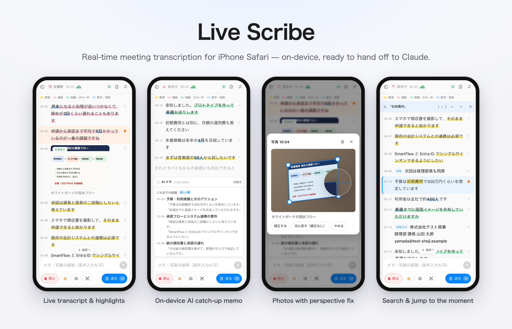
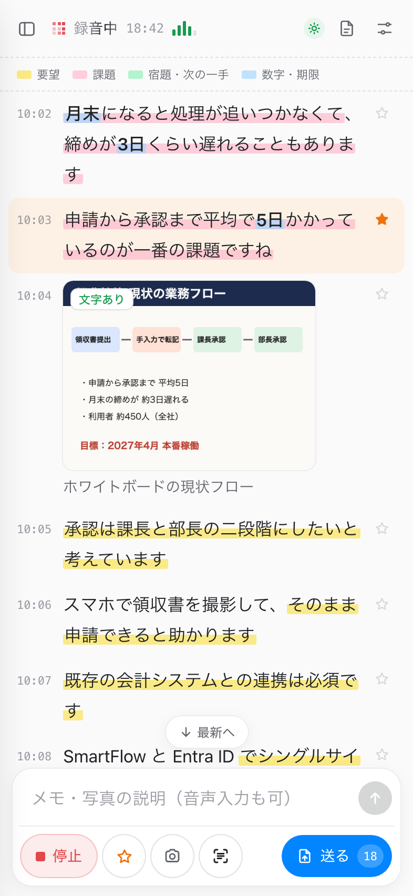
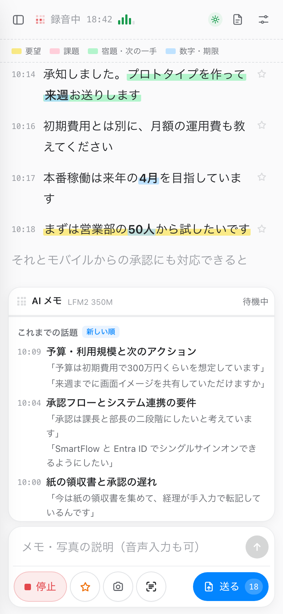
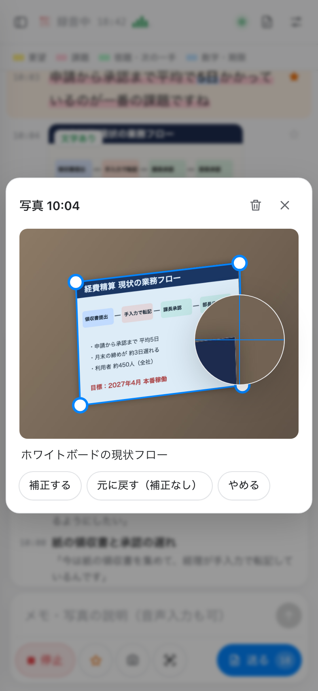
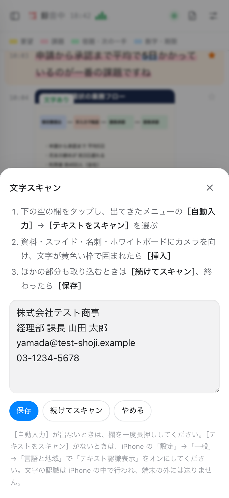
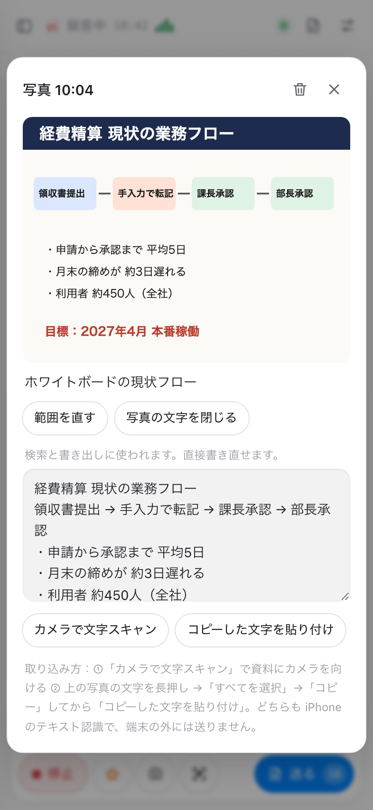
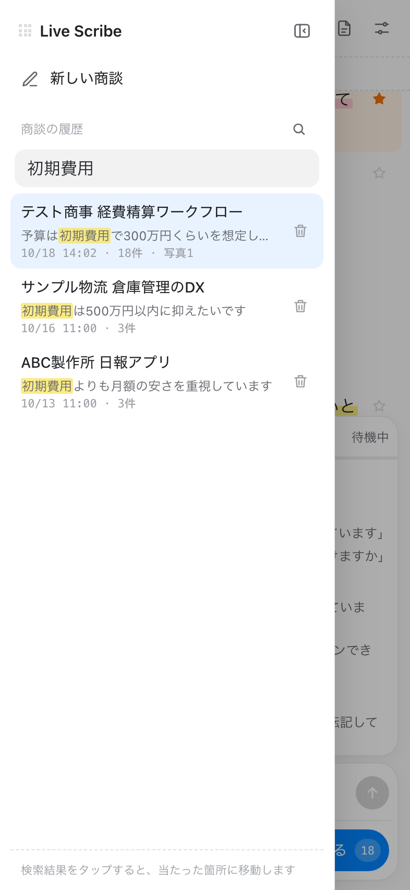
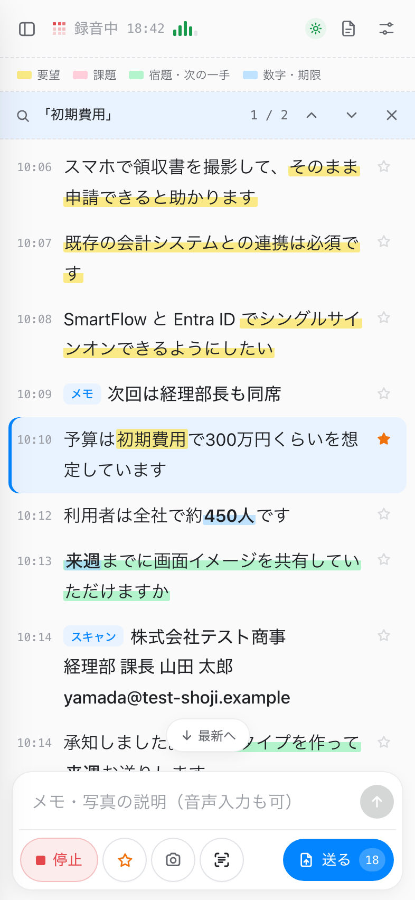
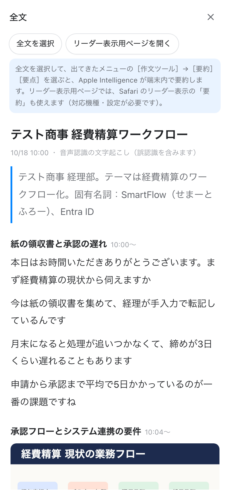
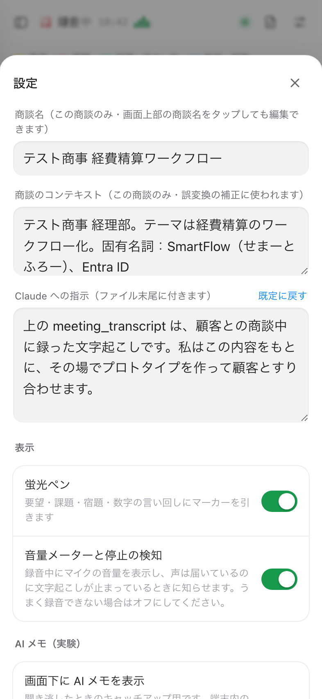

# Live Scribe



**Real-time meeting transcription that runs entirely in iPhone Safari.** Talk with your customer, and Live Scribe keeps a running transcript, highlights what matters, captures whiteboards and business cards, and packs everything into a file that Claude can read in one go. You can then build a prototype while the meeting is still going.

**Try it:** open **https://tubone24.github.io/live_scribe/** in Safari on your iPhone. There's nothing to install and no account to create. A visual user guide (in Japanese) is built into the app: [help.html](https://tubone24.github.io/live_scribe/help.html).

- 🎙️ **Live transcript**: uses the built-in speech recognition (Web Speech API, Japanese), with no server of its own
- 🖍️ **Auto highlights**: marks requests, pain points, to-dos, and numbers/deadlines as people speak
- 🧠 **On-device AI memo**: a small LLM in the browser gives each stretch of conversation a topic heading, so you can catch up on what you missed
- 📸 **Photos and text scanning**: perspective-corrects whiteboard photos and captures text from the camera with the iPhone's own text recognition
- 🔎 **Search and jump**: searches all past meetings, then jumps straight to the moment a keyword was said
- 📦 **One-tap hand-off to Claude**: exports a zip with an XML-tagged transcript, your notes, photos, and instructions
- 🔒 **Private by design**: audio is never stored, and text and photos stay in the browser on your phone (IndexedDB)

> The UI is in Japanese and the speech recognition is set to `ja-JP`. The screenshots below use a sample meeting about digitizing expense reports.

---

## Features

### Live transcript with highlights

<table>
<tr>
<td width="50%"></td>
<td>

Text streams in as people speak. The words still being recognized appear in a faded shimmer, and each line is final once the speaker pauses.

- **Highlighter** (rule-based): 🟨 requests, 🟥 pain points, 🟩 to-dos and next steps, 🟦 numbers and deadlines
- **☆ Star** the line that was just said with one tap. Starred lines are listed separately in the export.
- **Notes**: type (or dictate) into the bottom field. A note written right before taking a photo becomes that photo's caption.
- **Mic level meter** in the header. If your voice is reaching the mic but transcription has stopped, the app warns you.
- **The screen stays on** while recording (Wake Lock), shown by the small green sun icon.

</td>
</tr>
</table>

### On-device AI catch-up memo

<table>
<tr>
<td width="50%"></td>
<td>

About every two minutes of conversation (≈600 characters), a small LLM running **in the browser** (transformers.js + WebGPU, LFM2 350M by default) writes a topic heading. Under each heading it quotes the most representative lines **word for word**, so nothing is paraphrased away.

- Tap a topic to jump to where it started.
- When you stop recording, the meeting gets an automatic title. A title you typed yourself is never overwritten.
- The model is downloaded once from Hugging Face and cached in the browser, and the transcript never leaves the device.
- Requires Safari on iOS 26 or later. Turn it on in Settings → AI メモ.

</td>
</tr>
</table>

### Photos with perspective correction

<table>
<tr>
<td width="50%"></td>
<td>

The 📷 button inserts a photo at the moment it was taken in the transcript. It works well for whiteboards, handouts, slides, and existing screens.

With **perspective correction** turned on (OpenCV.js, about 10 MB the first time), the four corners of the document are detected and the photo is flattened as if it had been taken head-on. The original photo is kept.

If the detection misses, tap the photo → **範囲を直す** and drag the corners. A magnifier loupe follows your finger so the corner stays visible.

</td>
</tr>
</table>

### Capture text with the iPhone's text recognition

<table>
<tr>
<td width="50%"></td>
<td width="50%"></td>
</tr>
<tr>
<td>

**Text scan** (the button next to the camera): tap the empty field → **自動入力 (AutoFill) → テキストをスキャン (Scan Text)**, point the camera at a business card, slide, or whiteboard, and tap **挿入 (Insert)**. Use **続けてスキャン** to grab several areas in a row.

If you took a photo in the last 3 minutes, the text is attached to that photo. Otherwise it is inserted as a "スキャン" note.

</td>
<td>

**Text on a photo**: open a photo → **写真の文字を取り込む**. You can scan the text with the camera, or long-press the text in the photo (Live Text) to copy it and then paste it in. You can also edit the text by hand.

Photos with captured text show a 文字あり badge. The text is used for search and exported as `<ocr>`. Recognition happens on the iPhone, so no model is downloaded.

</td>
</tr>
</table>

### Search all meetings and jump to the moment

<table>
<tr>
<td width="50%"></td>
<td width="50%"></td>
</tr>
<tr>
<td>

The ☰ drawer lists every meeting stored on the phone. Search covers titles, context, topic headings, transcript lines, notes, photo captions, and photo text.

Full-width and half-width characters, upper and lower case, and katakana and hiragana are all treated the same. Separate words with spaces to require all of them (AND search).

</td>
<td>

**Tap a result** to open that meeting scrolled to the matching line. The search term is highlighted. Use **▲ ▼** in the find bar to step through every hit, and **×** to close it.

Optional **reading search** (kuromoji.js, about 18 MB) also matches words by their pronunciation. This catches speech-recognition homophone mistakes (経費/軽費 and so on), and those hits are labeled 読み一致.

</td>
</tr>
</table>

### Hand off to Claude

<table>
<tr>
<td width="50%"></td>
<td>

**送る (Send)** downloads everything since the last send as a zip containing a text file and an `images/` folder. Open it from the Files app and share it to Slack, Claude, or anywhere else. The clipboard is never used.

The text is structured for an LLM: the data is wrapped in XML tags, and your instructions go at the end. Edit the meeting context (customer, product names) and the instructions in Settings.

The **full text** view (📄 in the header) lets you select everything and summarize it with **Apple Intelligence Writing Tools**. `reader.html` also works with Safari Reader's summary.

</td>
</tr>
</table>

```xml
<meeting_transcript session="20261018-1000" title="テスト商事 経費精算ワークフロー" date="2026-10-18" part="1" range="10:00-10:18">
<context>テスト商事 経理部。テーマは経費精算のワークフロー化 …</context>
<notes description="…">- [10:09] 次回は経理部長も同席</notes>
<important description="…">- [10:10] 予算は初期費用で300万円くらいを想定しています</important>
<images description="…">
- [10:04] images/photo-01_1004.jpg 説明: ホワイトボードの現状フロー
  <ocr warped="yes">経費精算 現状の業務フロー …</ocr>
</images>
<transcript description="…">[10:00] 本日はお時間いただきありがとうございます …</transcript>
</meeting_transcript>
<instructions>… what Claude should organize: needs, constraints, screens to prototype, open questions …</instructions>
```

### Context, instructions, and settings

<table>
<tr>
<td width="50%"></td>
<td>

- **Meeting context**: the customer, the theme, and proper nouns. Claude uses it to fix misrecognized words. Writing a name as `表記（よみ）` also teaches the reading search how it is pronounced.
- **Instructions for Claude** are appended to every export. Reset them to the default at any time.
- Every feature that downloads a model is **off by default** and asks before downloading.
- **Memory & processing status** (Settings → メモリと処理の状態, or tap the MB chip in the header):
  - Which models are loaded and roughly how much memory they use, with a button to unload them.
  - On iPhone, heavy models are loaded **one at a time**.
  - If Safari reloads the tab because it ran out of memory, the next launch tells you what was running at the time.

</td>
</tr>
</table>

---

## Getting started

1. Open **https://tubone24.github.io/live_scribe/** in **Safari** on your iPhone.
2. Allow the microphone (Settings → Apps → Safari → Microphone), and make sure Siri / Dictation is enabled.
3. Tap **録音開始 (Start)** and talk. Star important lines, add notes, and take photos as you go.
4. Tap **送る (Send)**, then open the zip from Files → Downloads and share it to Claude or Slack.

### Add to Home Screen

Use Share → **Add to Home Screen**. The manifest uses `display: browser`, so the icon still opens in Safari.

If the sheet shows an **Open as Web App** switch, turn it **off**. Standalone web apps may not get speech recognition, and they keep their storage separate from Safari. The app shows a notice and an "Open in Safari" link if this happens.

## Privacy

- **Audio is never recorded or stored.** Speech recognition is provided by the browser (Apple's on iOS).
- Text, photos, and captured text are stored **only in this browser's IndexedDB**. Nothing is uploaded, and the app has no server of its own.
- The only network requests are one-time downloads of libraries and models, which are then cached in the browser:
  - AI memo model from Hugging Face
  - kuromoji dictionary and OpenCV.js from jsDelivr
- Exports are created only when you tap Send or download.

## Requirements

| | |
|---|---|
| Transcription | iPhone Safari (Web Speech API, `ja-JP`) |
| AI memo | Safari on iOS 26+ (WebGPU), about 255 MB model |
| Text scan | iOS with Live Text (Settings → General → Language & Region → Live Text) |
| Perspective correction | Any modern browser (OpenCV.js WASM, about 10 MB) |
| Desktop Chrome | Works for review, search, and export. Speech recognition depends on the browser. |

## How it's built

A single static `index.html` with no build step, plus one Web Worker per heavy task, hosted on GitHub Pages.

| File | Role |
|---|---|
| `index.html` | UI, storage (IndexedDB), export, search, job queue |
| `llm-worker.js` | On-device LLM for the AI memo (transformers.js + WebGPU) |
| `yomi-worker.js` | Reading search (kuromoji.js + IPADIC, cached in Cache Storage) |
| `cv-worker.js` | Perspective detection and correction (OpenCV.js) |
| `reader.html` | Page for Safari Reader's summary |

Heavy work goes through one queue that runs a single job at a time, and it never runs alongside the LLM. On memory-constrained devices, idle workers are stopped after 60 seconds, and the LLM is unloaded before photo processing and reloaded when recording resumes.
